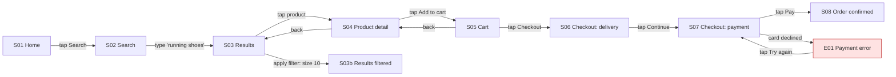

# Flow Mapping

## Mermaid flow template

Naming:
- Screen IDs (S01, S03b, E01 for errors, O01 for overlays) used as frame names in the design file.
- Edge labels are the user action ("tap Add to cart"), not the result.

## Coverage matrix

| Screen | T1 Find shoes | T2 Buy shoes | T3 Return an order | Built? |
|--------|---------------|--------------|--------------------|--------|
| S01 Home | start | start | start | yes |
| S02 Search | x | x | | yes |
| S03 Results | end | x | | yes |
| S04 Product | | x | | yes |
| S07 Payment | | x | | yes |
| E01 Payment error | | alt | | yes |
| S20 Orders | | | x | no -> build |
| S12 Wishlist | | | | yes -> cut |

Screens nobody's task touches are cut (or kept only as off-path dead ends with an overlay). Screens on a task path that
aren't built block the test.

## Click counts

For each task, count interactions on the expected path (from the graph):

| Task | Path | Clicks / taps |
|------|------|---------------|
| T1 Find running shoes in size 10 | S01 -> S02 -> S03 -> S03b | 3 |
| T2 Buy them | S03b -> S04 -> S05 -> S06 -> S07 -> S08 | 5 |

Compare with the current product or competitors when click count is a hypothesis.

## Graph QA by hand

Walk the graph, not the screens:
1. **Out-edges:** every node except success screens has at least one forward edge; every non-start node has a back edge
   (or system back works).
2. **Reachability:** from each task's start node, every node on that task's path is reachable.
3. **Targets:** every edge points to a node that exists (frame names match).
4. **Loops:** error loops return to the right screen with state preserved (the payment form keeps the entered address).
5. **Alternates:** for each step, list the most likely wrong turn; decide: build it, or show the off-path overlay.
